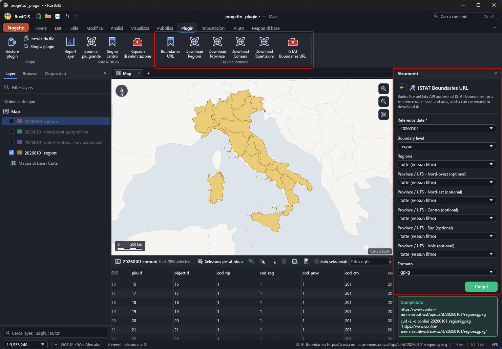

# ISTAT Boundaries (RustGIS plugin)

Download the Italian administrative boundaries published by ISTAT, served by the
[onData API](https://www.confini-amministrativi.it/), into [RustGIS](https://rustgis.app).
Inspired by the QGIS plugin [ondata/istat_boundaries_downloader](https://github.com/ondata/istat_boundaries_downloader).

Data URL pattern: `https://www.confini-amministrativi.it/api/v2/it/<date>/<level>.<format>`

## Requirements

RustGIS 0.2.1 or later. Permissions: `edit` and `network` (the plugin asks RustGIS to download
the file with `layer.addUrl`; the plugin itself has no network access).

## Install

Plugins › Plugin Manager › install the `.rgplugin` from the releases, or build it (below).

## Use

*[Guida in italiano](GUIDA.md)*

### Buttons (Plugins tab)

- **Add Ripartizioni**: the 5 geographic areas (Nord-ovest, Nord-est, Centro, Sud, Isole).
- **Add Regioni**: the 20 regions.
- **Add Province**: the provinces and metropolitan cities.
- **Add Comuni**: every comune of Italy (a large file, it takes a few seconds more).
- **Boundaries URL**: shows the address of the regions' data in the status bar.

The buttons use the boundaries at 1 January 2026.

> [!IMPORTANT]
> The data are added to the project, not saved in a folder. To get the file on disk, see [Saving the data on disk](#saving-the-data-on-disk).

### Saving the data on disk

RustGIS downloads the GeoPackage and keeps the layers in the project, without saving the file. To get it in a folder:

1. select the added layer;
2. use **Publish › Output › Export Features**;
3. choose the folder, the name and the format (GeoPackage, GeoJSON, Shapefile, CSV, KML…).

The saved file is the layer as RustGIS loaded it, not a copy of the API's original file.

### Other dates and areas: the tool

The **ISTAT Boundaries URL** tool (Geoprocessing, *ISTAT Boundaries* toolbox) has a form with the reference date (1991 to 2026), level, region, province and format. It builds the data's address and a `curl` command to download it. The tool can't add layers: download the file and open it with **Add Data**, or use the address with **Add Data › From URL**.

### From a script

The commands take parameters, for example the comuni of Basilicata in 2020:

```
plugin:istat-boundaries/download-comuni={"date": "20200101", "region": "17"}
```

Parameters: `date` (YYYYMMDD), `level` (`regioni`, `province`, `comuni`, `ripartizioni`), `region` (`cod_reg`), `province` (`cod_uts`), `format` (`gpkg`, `zip`, `csv`, `kml`, `kmz`).

### Codes

- Regions, `cod_reg`: 1 = Piemonte … 20 = Sardegna.
- Provinces, `cod_uts`: for example 201 = Torino.
- Without leading zeros (`1`, not `01`). The form's menus list the 2026 units: for older dates the codes can differ.



## Build

```sh
rustup target add wasm32-unknown-unknown
python scripts/package.py      # -> dist/istat-boundaries-<version>.rgplugin
cargo test
```

## Credits

Boundaries are served by the [onData](https://github.com/ondata) API at
[confini-amministrativi.it](https://www.confini-amministrativi.it), created by Alessio Cimarelli.
This plugin is inspired by the QGIS plugin
[istat_boundaries_downloader](https://github.com/ondata/istat_boundaries_downloader).

## License

The plugin code is MIT.

The data are by ISTAT, served by [confini-amministrativi.it](https://www.confini-amministrativi.it), and
are released under [CC BY 4.0](https://creativecommons.org/licenses/by/4.0/deed.it) unless stated
otherwise (see the [ISTAT legal notes](https://www.istat.it/note-legali/)). When you reuse them, credit
ISTAT, link the licence and say whether you changed the data.
